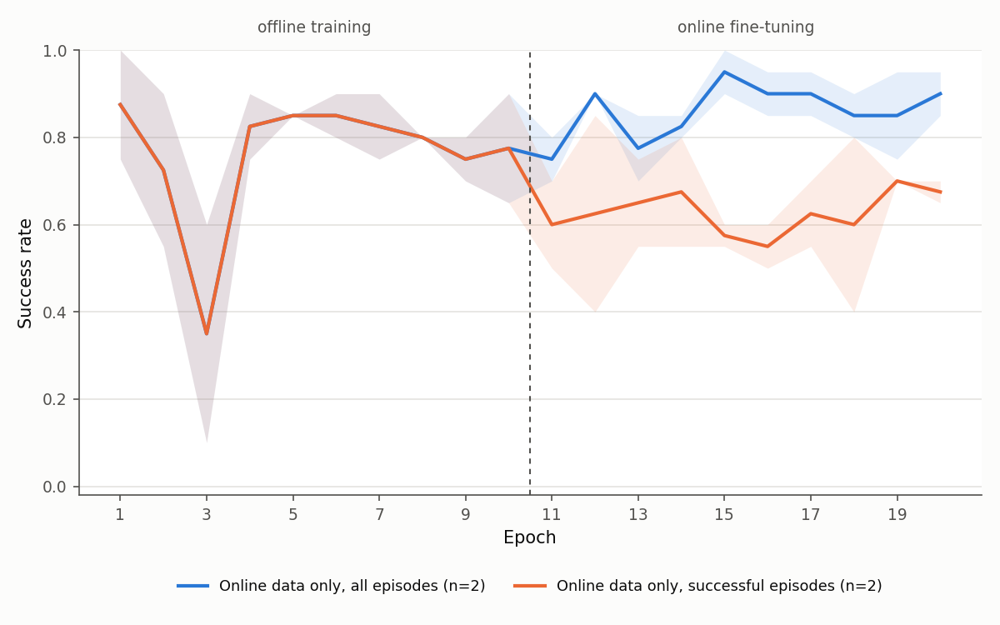

# offline2online_gcrl

Offline-to-online goal-conditioned reinforcement learning in JAX.

An agent is first trained on a fixed dataset of demonstrations, then fine-tuned online by collecting its own
experience in many simulated environments running in parallel on the GPU ([Brax](https://github.com/google/brax) +
[MuJoCo MJX](https://mujoco.readthedocs.io/en/stable/mjx.html)). Environment stepping,
replay buffers and gradient updates all run inside one compiled JAX program.

The repository combines goal-conditioned agents from [OGBench](https://github.com/seohongpark/ogbench)
([Park et al., 2025](https://arxiv.org/abs/2410.20092)) with the GPU environments and trajectory replay buffer from
[JaxGCRL](https://github.com/MichalBortkiewicz/JaxGCRL) ([Bortkiewicz et al., 2025](https://arxiv.org/abs/2408.11052)),
and adds:

- an offline phase followed by an online phase whose batches mix offline and online data;
- optional filtering of online experience so that only episodes that reach their goal enter the online buffer;
- a scripted demonstration generator for a Franka Panda pick-and-place task.

## How it works

1. **Offline phase.** The agent trains on the offline buffer only. Each sample is a trajectory segment; for every
   state, a later state from the same trajectory is drawn as the goal (hindsight relabelling,
   [Andrychowicz et al., 2017](https://arxiv.org/abs/1707.01495), with geometric weighting by `discount`). Following
   OGBench, the reward is -1 per step and 0 when the next state is the goal, so values count steps to the goal.
2. **Seeding.** The online buffer is filled with `seed_steps` environment steps from the current policy.
3. **Online phase.** Each iteration collects `unroll_length` steps in every parallel environment, adds them to the
   online buffer, and trains on batches mixing both buffers (`offline_data_ratio` from the offline one, half by default,
   as in RLPD's symmetric sampling, [Ball et al., 2023](https://arxiv.org/abs/2302.02948)).

With `insert_only_successful_episodes: True`, step 3 keeps only transitions from episodes that reached the goal within
the unroll, so only successful episodes are relabelled into training data. Without it, failed attempts are relabelled
too, as successes for whatever goal they happened to reach.

## Installation

Requires Python 3.10 and an NVIDIA GPU with CUDA 12.

```bash
python3.10 -m venv .venv && source .venv/bin/activate
pip install -r requirements.txt   # exact versions used for development
pip install -e .
```

## Data

Datasets are stored as `.npz` files with one stacked array per field (`observation`, `next_observation`, `action`,
`reward`, `terminate`, `truncation`, `traj_id`) in `offline2online_gcrl/data_generation/data/`.

Three `arm_binpick_easy_EEF` datasets are included:

| File | Transitions | Successful episodes | Used for |
|---|---|---|---|
| `arm_binpick_easy_EEF_goal_thresh_0.01.npz` | 105,713 (1,501 episodes) | 47% | Main experiments: first 20k transitions (278 episodes, 44% successful), set by `max_offline_transitions` |
| `arm_binpick_easy_EEF_lowsuccess_20k.npz` | 20,013 (264 episodes) | 15% | Learning from mostly failed demonstrations |
| `arm_binpick_easy_EEF_failuresonly_20k.npz` | 20,034 (251 episodes) | 0% | Learning from failed demonstrations only |

The two 20k subsets are random whole episodes from the full dataset. To generate new data, each task has a scripted
pick-and-place controller with per-episode Gaussian action noise.

```bash
# arm_binpick_easy_EEF (end-effector control)
python -m offline2online_gcrl.data_generation.generate_binpick_EEF --num_episodes=1000 \
    --save_path=./offline2online_gcrl/data_generation/data/arm_binpick_easy_EEF.npz

# arm_binpick_easy (joint control, via inverse kinematics)
python -m offline2online_gcrl.data_generation.generate_binpick \
    --env_name=arm_binpick_easy --num_episodes=100 --num_envs=10 \
    --save_path=./offline2online_gcrl/data_generation/data/arm_binpick_easy.pkl --html_viz=False
```

The joint-control generator writes the raw rollouts to `arm_binpick_easy.pkl` and the training dataset to
`arm_binpick_easy.npz`.

Older datasets saved as a pickled list of per-transition dicts can be converted once:

```bash
PYTHONPATH=. python scripts/convert_dataset_to_npz.py path/to/dataset.pkl
```

## Training

```bash
PYTHONPATH=offline2online_gcrl/impls:. python offline2online_gcrl/impls/main_off_on.py \
    --train_config_path=configs/train_config.yaml \
    --agent=offline2online_gcrl/impls/agents/gcivl_jax.py \
    --agent.batch_size=100
```

Settings are read from [configs/train_config.yaml](configs/train_config.yaml); the defaults reproduce the
online-only, all-episodes setting from the results below. Agent hyperparameters come from the
agent file and can be overridden on the command line (`--agent.<name>=<value>`). The same agent is used in both
phases.

| Setting | Meaning |
|---|---|
| `env_name`, `dataset_name` | Environment and offline dataset (`<dataset_folder>/<dataset_name>.npz`). |
| `num_envs` | Parallel environments. `(episode_length - 1) * num_envs` must be divisible by the agent's `batch_size`. |
| `offline_train_steps`, `online_train_steps` | Length of each phase, in environment-step units. |
| `num_training_steps_per_iteration` | Training steps per collected unroll (update-to-data ratio). |
| `insert_only_successful_episodes` | Keep only episodes that reach their goal in the online buffer. |
| `offline_data_ratio` | Fraction of each online-phase batch drawn from the offline buffer (default 0.5). |
| `action_sample_temperature` | Scales the policy's action noise during online collection. |
| `max_offline_transitions` | Use only the first N offline transitions (`null` for all). |
| `visualization_interval` | Render an HTML rollout every N epochs; `0` disables rendering. |
| `log_wandb` | Log metrics to Weights & Biases. |

Each run writes to `<save_dir>/<project_name>/<experiment_name>/<job_name>/`: `metrics.csv` with one row per
evaluation, checkpoints every `save_interval` epochs, and `final.pkl` at the end.

## Evaluation

```bash
PYTHONPATH=offline2online_gcrl/impls:. python scripts/evaluate.py \
    --train_config_path=configs/train_config.yaml \
    --agent=offline2online_gcrl/impls/agents/gcivl_jax.py \
    --checkpoint=path/to/final.pkl --num_episodes=50 --render_dir=path/to/output
```

Prints the success rate over `num_episodes` parallel episodes and, with `--render_dir`, writes an HTML rollout that
can be opened in a browser. Use the same config and agent settings as the training run.

## Agents

| Agent | File | Notes |
|---|---|---|
| GCIVL | `agents/gcivl_jax.py` | Goal-conditioned implicit V-learning with an AWR actor ([Park et al., 2025](https://arxiv.org/abs/2410.20092)). |
| GCIQL | `agents/gciql_jax.py` | Goal-conditioned implicit Q-learning; DDPG+BC (default) or AWR actor ([Park et al., 2025](https://arxiv.org/abs/2410.20092)). |
| GCQL | `agents/gcql_jax.py` | Goal-conditioned Q-learning; DDPG (default) or AWR actor. |
| IQL | `agents/iql.py` | Implicit Q-learning ([Kostrikov et al., 2022](https://arxiv.org/abs/2110.06169)) on the task reward, without goal relabelling; run with `goal_conditioning: 0`. |

Continuous-action actors use a state-dependent standard deviation and tanh squashing, so actions stay in (-1, 1).

## Environments

| Name | Task | Control |
|---|---|---|
| `arm_binpick_easy` | Move a cube from a random spot in one bin to the centre of another (5-dim actions) | Joint angles of the Franka arm |
| `arm_binpick_easy_EEF` | Same task with a free-floating gripper (4-dim actions) | End-effector position deltas |

Both are adapted from JaxGCRL's manipulation suite. Success means the cube is within `goal_reach_thresh` of the goal
(1 cm for the EEF task), and an episode ends as soon as the goal is reached.

## Results

We evaluate whether established offline-to-online RL findings transfer to goal-conditioned RL (GCRL):

- [WSRL](https://arxiv.org/abs/2412.07762) shows that standard RL fine-tuning need not retain offline data, provided the
  critic is first recalibrated on rollouts from the pre-trained policy. Does the same hold for GCRL?
- Success-based curation, as in [Demo-SCORE](https://arxiv.org/abs/2503.03707) and filtered imitation, keeps only
  successful data. Does keeping only successful *online* episodes help GCRL fine-tuning?
- Hindsight relabelling ([HER](https://arxiv.org/abs/1707.01495)) turns failed episodes into examples of reaching other
  goals. How much does GCRL depend on successful demonstrations?

**Setup.** `arm_binpick_easy_EEF`, GCIVL, 20k offline transitions (278 scripted demonstrations, 44% successful),
25 parallel environments, about one gradient update per collected transition. Each seed trains offline once
(10 epochs); every online variant starts from that same checkpoint and fine-tunes for 10 epochs (~500k environment
steps). The online buffer is seeded with 5k steps of the pre-trained policy, as in WSRL's warm-up. Success means the
cube ends within 1 cm of the target.

All numbers are success rates of the **final checkpoint over 200 evaluation episodes**. Changes are in percentage
points relative to the offline checkpoint each run started from.

### 1. Keeping failed online episodes beats filtering to successes (2 seeds)

| Online data used during fine-tuning | Seed 0 | Seed 1 | Mean change |
|---|---|---|---|
| — (offline checkpoint) | 0.775 | 0.845 | |
| All episodes | 0.900 | 0.930 | **+10.5%** |
| Successful episodes only | 0.685 | 0.560 | **−18.7%** |

Both variants train on online data alone (no offline data is replayed during fine-tuning). From the same starting
policy, keeping every episode improves success, while keeping only successful episodes degrades it below the offline
policy, on both seeds. This is the opposite of success-based curation in imitation learning: in GCRL, hindsight
relabelling turns failed episodes into valid examples of reaching the goals they did reach, so discarding them removes
useful data.



*Mean over seeds (lines) and range (shaded), 20 evaluation episodes per epoch. Both variants share the offline phase.*

Fine-tuning on online data alone also did not collapse, consistent with [WSRL](https://arxiv.org/abs/2412.07762):
retaining offline data during fine-tuning was not needed here.

### 2. GCRL learns the task from failed demonstrations (3 seeds)

| Successful episodes in the offline data | Seed 0 | Seed 1 | Seed 2 | Mean |
|---|---|---|---|---|
| 44% (main dataset) | 0.775 | 0.845 | 0.680 | **0.77** |
| 15% | 0.695 | 0.795 | 0.760 | **0.75** |
| 0% (failures only) | 0.665 | 0.555 | 0.695 | **0.64** |

Each dataset has 20k transitions (`arm_binpick_easy_EEF_goal_thresh_0.01`, `..._lowsuccess_20k`,
`..._failuresonly_20k`). Trained only on episodes that never place the cube within 1 cm of the target, the offline
policy succeeds 64% of the time; a few successful demonstrations raise this to ~75%, and more add little.

### Limitations

One task, one algorithm (GCIVL), 2–3 seeds. The offline policies start at ~0.75, which limits the room for online
improvement. We did not compare fine-tuning with and without retained offline data in this final setup.

Reproduce the summary and figures with:

```bash
python3 scripts/summarize_results.py <save_dir>/<project_name>
python scripts/plot_results.py --runs_dir=<save_dir>/<project_name> --out_dir=docs/figures
```

## References

- Park, Frans, Eysenbach, Levine. *OGBench: Benchmarking Offline Goal-Conditioned RL.* ICLR 2025. [arXiv:2410.20092](https://arxiv.org/abs/2410.20092)
- Bortkiewicz et al. *Accelerating Goal-Conditioned Reinforcement Learning Algorithms and Research* (JaxGCRL). ICLR 2025. [arXiv:2408.11052](https://arxiv.org/abs/2408.11052)
- Andrychowicz et al. *Hindsight Experience Replay.* NeurIPS 2017. [arXiv:1707.01495](https://arxiv.org/abs/1707.01495)
- Kostrikov, Nair, Levine. *Offline Reinforcement Learning with Implicit Q-Learning.* ICLR 2022. [arXiv:2110.06169](https://arxiv.org/abs/2110.06169)
- Peng et al. *Advantage-Weighted Regression.* 2019. [arXiv:1910.00177](https://arxiv.org/abs/1910.00177)
- Ball, Smith, Kostrikov, Levine. *Efficient Online Reinforcement Learning with Offline Data* (RLPD). ICML 2023. [arXiv:2302.02948](https://arxiv.org/abs/2302.02948)
- Lee et al. *Offline-to-Online Reinforcement Learning via Balanced Replay and Pessimistic Q-Ensemble.* CoRL 2021. [arXiv:2107.00591](https://arxiv.org/abs/2107.00591)
- Zhou, Peng, Li, Levine, Kumar. *Efficient Online Reinforcement Learning Fine-Tuning Need Not Retain Offline Data* (WSRL). ICLR 2025. [arXiv:2412.07762](https://arxiv.org/abs/2412.07762)
- Chen, Lessing, Liu, Finn. *Curating Demonstrations using Online Experience* (Demo-SCORE). 2025. [arXiv:2503.03707](https://arxiv.org/abs/2503.03707)
- Freeman et al. *Brax: A Differentiable Physics Engine for Large Scale Rigid Body Simulation.* 2021. [arXiv:2106.13281](https://arxiv.org/abs/2106.13281)

## Acknowledgements and licence

Code derived from OGBench (MIT) and JaxGCRL (Apache-2.0) keeps its original licence; see [NOTICE.md](NOTICE.md) for
which files come from where, [LICENSE](LICENSE) and [LICENSE-JAXGCRL](LICENSE-JAXGCRL).
